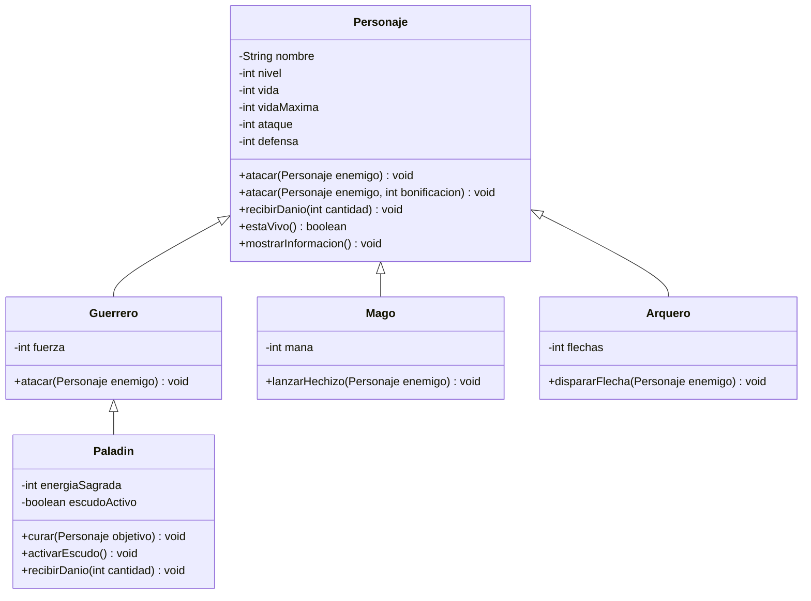
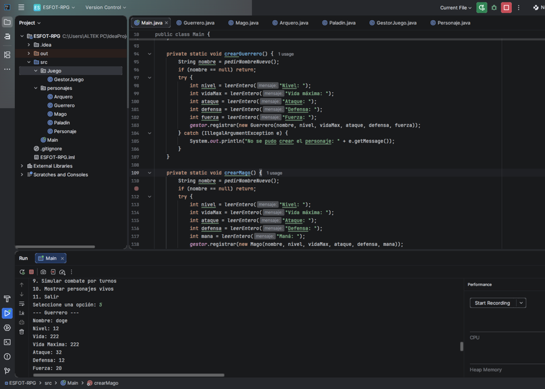
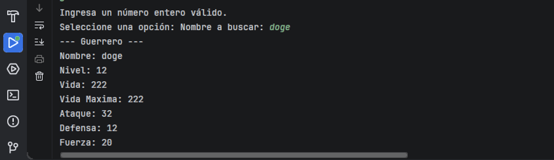
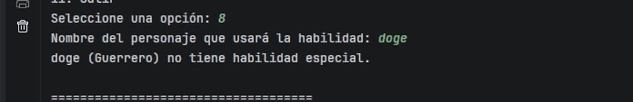
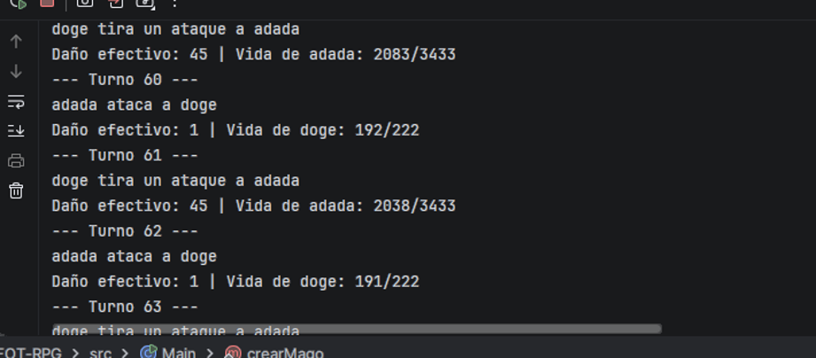

# ESFOT RPG: La Batalla de los Reinos

Este proyecto es un juego de rol por consola hecho en Java. Se pueden crear guerreros, magos, arqueros y paladines, ver sus datos, buscarlos por nombre, hacer que ataquen y ponerlos a pelear por turnos. Lo hice para practicar herencia, encapsulamiento, sobrescritura, sobrecarga, polimorfismo y colecciones.

## Cómo ejecutarlo

Se abre el proyecto en IntelliJ y se ejecuta la clase Main. Sale un menú y se elige la opción escribiendo el número, del 1 al 11.

## Herencia

Personaje es la clase padre. Guerrero, Mago y Arquero heredan de Personaje, y Paladin hereda de Guerrero. Con eso se usan los tres tipos de herencia: simple (Guerrero de Personaje), jerárquica (Guerrero, Mago y Arquero del mismo padre) y multinivel (Paladin de Guerrero y Guerrero de Personaje).

## Cómo funciona el juego

Cuando alguien recibe un ataque, el daño es la potencia menos su defensa, pero siempre hace al menos 1 de daño. La vida nunca baja de 0 ni sube más de la vida máxima.

El guerrero suma su fuerza cuando ataca. El mago lanza hechizos que gastan 10 de maná y atacan con 20. El arquero gasta una flecha por disparo y ataca con su ataque más 5. El paladín puede curar (gasta 10 de energía y recupera hasta 20 de vida) y activar un escudo que le quita 5 de daño al siguiente ataque que reciba.

No se puede repetir el nombre de un personaje y los personajes derrotados no pueden atacar ni ser atacados. Si falta maná, flechas o energía, el programa avisa y no gasta nada.

## Diagrama UML

## Capturas de pantalla

## Preguntas
1. ¿Dónde se aplica herencia simple en el proyecto?

En Guerrero extends Personaje. El guerrero tiene un solo padre y usa lo que ya hace Personaje sin copiar el código.

2. ¿Por qué Personaje → Guerrero → Paladin representa herencia multinivel?

Porque son tres clases en cadena. Paladin hereda de Guerrero y Guerrero hereda de Personaje, entonces el paladín termina teniendo lo de las dos.

3. ¿Qué relación ejemplifica herencia jerárquica?

Guerrero, Mago y Arquero, porque los tres heredan del mismo padre, que es Personaje.

4. ¿Cuál es la diferencia entre sobrescritura y sobrecarga de atacar()?

La sobrecarga es tener el mismo nombre de método con otros parametros en la misma clase. La sobrescritura es cque la clase hija cambia un método del padre dejando el mismo nombre y los mismos parámetros.

5. ¿Qué aporta super en constructores y métodos?

En los constructores, super(...) le pasa los datos al constructor del padre. En los métodos, super.metodo() usa la versión del padre en vez de volver a escribirla. Por ejemplo, en Guerrero uso super.mostrarInformacion() y después imprimo la fuerza.

6. ¿Por qué List<Personaje> admite guerreros, magos, arqueros y paladines?

Porque todos son un Personaje. Un guerrero es un personaje, un mago también, en si todos son un "Personajke"

7. ¿Qué versión de mostrarInformacion() se ejecuta al recorrer la lista y por qué?

Se ejecuta la del objeto real. Si el elemento es un mago, sale la versión de Mago, aunque la lista sea de Personaje. Java decide cuál usar mientras el programa corre. A eso se le llama polimorfismo.

8. ¿Cuándo se necesita instanceof antes de hacer casting?

Cuando quiero usar un método que solo tiene una clase hija, como lanzarHechizo del mago. Con una referencia de tipo Personaje no puedo llamarlo. Primero pregunto con instanceof si es un Mago y después hago el casting. Si no reviso, el programa puede fallar. Al paladín lo reviso antes que al guerrero, porque un paladín también es un guerrero.

9. ¿Qué ventaja aporta HashMap para localizar un personaje por nombre?

Que busco al personaje directo por su nombre, sin recorrer toda la lista. También sirve para saber rápido si un nombre ya existe, con containsKey().

10. ¿Cómo se protege la consistencia de los atributos mediante encapsulamiento?

Los atributos son private, entonces nadie los puede cambiar directo desde afuera. Solo se cambian con los setters, que revisan el dato antes de guardarlo, por ejemplo que el nombre no esté vacío o que la vida esté entre 0 y la vida máxima. Si el dato no sirve, lanzan una excepción. Los constructores también usan los setters, así que no se puede crear un personaje con datos inválidos.